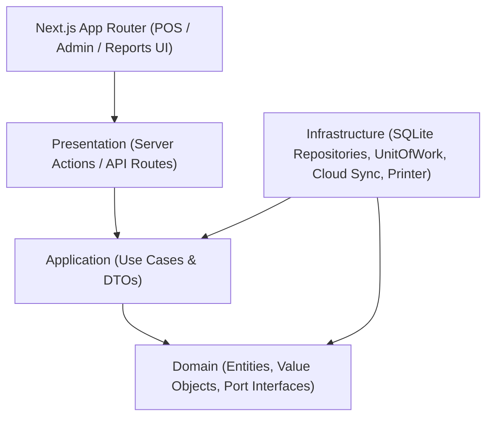

# Store Management System — Architecture & Implementation Plan

## 1. System Overview

A full-stack **Store Management & POS System** tailored for Sari-Sari stores and small retail businesses. It builds directly on [product-inventory-and-selling-options.md](file:///c:/Users/awen/Projects/store-management-system/docs/product-inventory-and-selling-options.md) and adheres to the **Module-First Clean Architecture** and coding standards defined in [AGENTS.md](file:///c:/Users/awen/Projects/store-management-system/AGENTS.md).

### Core Design Goals
- **Fast, Frictionless POS**: Support 1-tap selling options, barcode scanning, and ad-hoc "tingi" peso amounts.
- **Accurate Inventory & Profit**: Maintain stock in a single `base_unit` (`DECIMAL(12, 4)`), support bulk pack/box stock-ins, and snapshot `unit_price` and `unit_cost` (`DECIMAL(12, 2)`) on every sale.
- **Local-First Reliability**: Run smoothly offline on a local SQLite database with optional cloud backup and sync.
- **Modular & Testable**: Keep all business rules in `domain/` and `application/` layers, testable without a database or UI.

---

## 2. Tech Stack & Hybrid Storage

| Layer | Technology | Purpose |
|---|---|---|
| **Frontend & API** | Next.js (App Router), React, TypeScript (`strict: true`), Tailwind CSS | POS terminal, inventory admin, reports, and Route Handlers / Server Actions |
| **Validation & Domain** | Zod, TypeScript | Schema/boundary validation and pure domain entities |
| **Local Database** | SQLite (WAL mode) via Drizzle ORM (or Prisma) | Fast, zero-config local persistence that works offline |
| **Cloud Backup / Sync** | Pluggable Sync Adapter (e.g., Turso/libSQL, S3/R2, or Postgres sync) | Optional encrypted snapshots or incremental sync when internet is available |
| **Testing** | Vitest | Domain/application unit tests (in-memory fakes) and repository integration tests |

### Hybrid SQLite + Cloud Strategy
1. **Primary Store Operations**: All reads and writes hit the local SQLite database so checkout never stalls if Wi-Fi drops.
2. **Backup & Sync Port**: Defined as an interface in `shared/application/` (`BackupSyncPort`), allowing either scheduled SQLite snapshot uploads or incremental change-log sync without coupling business logic to a cloud provider.

---

## 3. Clean Architecture Module Map

```text
src/
├── shared/
│   ├── domain/                  # Decimal helpers, identifiers, base errors (implemented)
│   └── application/             # UnitOfWork, Clock, IdGenerator, BackupSyncPort
├── inventory/                   # Products, selling options, categories, suppliers, stock movements
├── sales/                       # POS checkout, cart calculation, receipts, returns/voids
├── credit/                      # Customer "Utang" ledger, credit limits, partial payments
├── shifts/                      # Users, Owner/Cashier roles, shift open/close & cash reconciliation
├── reports/                     # Read-only queries: daily/monthly revenue, COGS profit, low stock
└── hardware/                    # Ports & adapters for barcode scanner & thermal receipt printer
```

### Dependency Flow



---

## 4. Planned Modules & Capabilities

### 4.1 Inventory & Restocking (`inventory/`)
- **Status**: Domain entities implemented in [src/inventory/domain/entities/](file:///c:/Users/awen/Projects/store-management-system/src/inventory/domain/entities/index.ts).
- **Planned Use Cases**:
  - `CreateProduct`, `UpdateProduct`, `ManageSellingOptions`
  - `StockIn` (supports bulk pack/box multiplier: `entered_qty × option.quantity` added to `current_stock` with `supplier_id` and `unit_cost`)
  - `AdjustStock` (`ADJUSTMENT`, `DAMAGED`, `EXPIRED` with required remarks and sign rules)
  - `GetLowStockProducts` (`current_stock <= reorder_level`)

### 4.2 POS Checkout & Cart (`sales/`)
- **Selling Modes**:
  - Default base unit (`option_id = null`)
  - Preset `ProductSellingOption` (packs, bundles, promos, weight/volume presets)
  - Ad-hoc custom peso amount ("tingi") when `Product.allow_custom_amount = true` (`base_quantity = custom_amount / product.selling_price`)
- **Planned Use Cases**:
  - `CalculateCartTotals` (preview line subtotals and `base_quantity` deductions before checkout)
  - `ProcessSale` (executes inside `UnitOfWork`: validates stock, creates `SalesTransaction` + `SalesItem` snapshots, records negative `SALE` `InventoryTransaction`, deducts `Product.current_stock`, and optionally creates a `CreditTransaction` if paid via Utang)
  - `ProcessReturn` (records positive `RETURN` `InventoryTransaction` and restores stock)

### 4.3 Customer Credit / "Utang" Ledger (`credit/`)
- **Entities**:
  - `Customer`: `customer_id`, `full_name`, `phone`, `address`, `credit_limit`, `current_balance`, `is_active`
  - `CreditTransaction`: `credit_tx_id`, `customer_id`, `sale_id` (nullable), `type` (`CHARGE` | `PAYMENT`), `amount`, `remarks`, `created_by`, `created_at`
- **Rules**:
  - `SalesTransaction` supports payment breakdown (`CASH`, `CREDIT`, or `SPLIT` cash + credit).
  - Enforces optional `credit_limit` before approving a `CHARGE`.
  - Supports partial payments (`PAYMENT`) that reduce `current_balance`.

### 4.4 User Roles & Shift Management (`shifts/`)
- **Roles**:
  - `OWNER`: Full access (products, cost prices, stock adjustments, profit reports, user management, cloud backup).
  - `CASHIER`: POS checkout, customer utang payments (within limits), own shift open/close.
- **Shift Cash Drawer**:
  - `CashierShift`: `shift_id`, `user_id`, `opened_at`, `closed_at`, `opening_cash`, `expected_cash`, `actual_cash`, `variance`, `status` (`OPEN` | `CLOSED`).
  - `expected_cash = opening_cash + cash_sales + cash_utang_payments - cash_refunds`.

### 4.5 Sales & Profit Reports (`reports/`)
- **Daily & Monthly Summaries**: Gross sales, cash vs. credit collected, and net profit (`SUM(subtotal - base_quantity × unit_cost)`).
- **Product Performance**: Top-selling items by quantity and profit margin.
- **Inventory & Utang Health**: Low-stock alerts, stock valuation (`SUM(current_stock × cost_price)`), and aging unpaid customer balances.

### 4.6 Hardware Integration (`hardware/`)
- **USB Barcode Scanner**:
  - Keyboard-wedge input listener in the POS UI matching against `Product.barcode` **and** `ProductSellingOption.barcode` (scanning a box barcode automatically adds the Box option).
- **Thermal Receipt Printer (58mm / 80mm)**:
  - `ReceiptPrinterPort` in `hardware/domain/` with adapters for browser print CSS (`@media print` receipt layout) and optional local ESC/POS bridge (WebUSB / serial / local print agent).

---

## 5. Phased Implementation Roadmap

### Phase 1: Core Domain & Application Use Cases (In-Memory)
- Add `src/shared/application/` (`UnitOfWork`, `IdGenerator`, `Clock`).
- Add `inventory/` repository interfaces and `StockIn` / `AdjustStock` / `GetLowStockProducts` use cases.
- Add `sales/` `ProcessSale` and `ProcessReturn` use cases.
- Verify all business rules, stock deductions, and profit calculations using Vitest + in-memory repository fakes (no DB required).

### Phase 2: Local SQLite Persistence & Migrations
- Define SQLite schema (matching `DECIMAL(12, 2)` and `DECIMAL(12, 4)` precision rules) and Drizzle ORM repositories in `infrastructure/persistence/`.
- Implement SQLite `UnitOfWork` transaction manager.
- Add repository integration tests.

### Phase 3: Next.js POS & Inventory Admin UI
- Scaffold Next.js App Router + Tailwind CSS in `src/app/` (presentation layer).
- Build POS Checkout screen (search/barcode scan, selling option buttons, custom "tingi" modal, cart, payment & change calculator).
- Build Product & Inventory management screens (create product, configure selling options, bulk stock-in by pack/box).

### Phase 4: Utang Ledger, Roles, Shifts & Reports
- Implement `credit/`, `shifts/`, and `reports/` modules end-to-end.
- Add authentication/PIN login for Owner and Cashier roles.
- Build Shift Open/Close reconciliation and Sales/Profit dashboard.

### Phase 5: Hardware & Hybrid Cloud Sync
- Wire 58mm/80mm thermal receipt printing and keyboard-wedge barcode shortcuts.
- Implement `BackupSyncPort` for automated/manual local SQLite backup and optional cloud sync.

---

## 6. Verification Strategy
- **Unit Tests**: Every `domain/` and `application/` use case tested in isolation with in-memory fakes covering normal, boundary, and failure cases.
- **Integration Tests**: SQLite repository and `UnitOfWork` rollback tests to guarantee atomic sales + stock deductions.
- **Checks Before Every Commit**:
  ```bash
  npm run typecheck
  npm test
  ```
