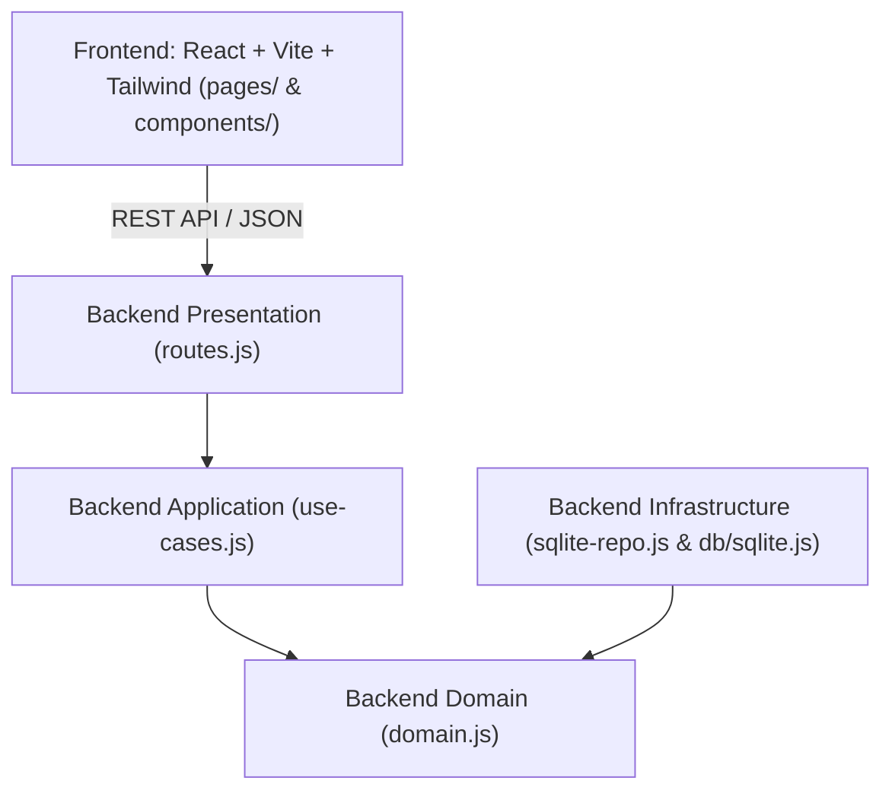

# Store Management System — Current Architecture & Roadmap

## 1. System Overview

A full-stack **Store Management & POS System** tailored for Sari-Sari stores and small retail businesses. It builds directly on [product-inventory-and-selling-options.md](./product-inventory-and-selling-options.md) and follows the module-first Clean Architecture described in [`ARCHITECTURE.md`](../ARCHITECTURE.md).

> **Document status:** Sections describing the current system are authoritative for implemented behavior. Items under the roadmap are planned or deferred and must not be treated as available features.

### Core Design Goals
- **Fast, Frictionless POS**: Support 1-tap selling options, barcode scanning, and ad-hoc "tingi" peso amounts.
- **Owner-First, Clutter-Free UI**: No overloaded text, filler descriptions, or extra labels—every screen shows only what the business owner or cashier needs for that exact use case.
- **Accurate Inventory & Profit**: Maintain stock in a single `base_unit` (`DECIMAL(12, 4)`), support bulk pack/box stock-ins, and snapshot `unit_price` and `unit_cost` (`DECIMAL(12, 2)`) on every sale.
- **Local-First Reliability**: Run smoothly offline on a local SQLite database with operational volume backups and optional cloud sync later.
- **Philippine Retail Defaults**: Currency is `PHP (₱)` and business day cutoffs use `Asia/Manila` (`UTC+8`).
- **Modular & Testable**: Keep all business rules in `domain.js` and `use-cases.js`, testable without a database or UI.

## Current implementation status

- **Implemented backend modules:** authentication and RBAC, inventory, selling options, stock movements, sales, returns, customer credit, cashier shifts, cash movements, and reports.
- **Implemented frontend screens:** setup, login, dashboard, POS, inventory, customers/utang, transactions, and owner-only reports.
- **Implemented deployment:** Docker Compose, Nginx proxy, health checks, persistent SQLite/uploads volume, and CI image publishing.
- **Deferred:** direct ESC/POS hardware integration, automated cloud synchronization, and future modules not present in the repository.

---

## 2. Tech Stack & Storage

| Layer | Technology | Purpose |
|---|---|---|
| **Backend API (`backend/`)** | Node.js, Express, JavaScript (ESM, no TypeScript) | Standalone REST API server, middleware, and Clean Architecture modules |
| **Frontend UI (`frontend/`)** | React, Vite, JavaScript / JSX (no TypeScript), Tailwind CSS | Lightweight POS terminal, inventory admin, and reports SPA calling the Express API |
| **Frontend State** | Built-in React state (`useState`, `useReducer`, `useContext`) | Local feature state (e.g., POS cart) and lightweight session/shift context (no external state library) |
| **Validation & Domain** | Plain JavaScript (ESM) | Plain JS boundary validators and pure domain entities (no TypeScript, no Zod) |
| **Local Database** | SQLite (WAL mode) via built-in `node:sqlite` (plain SQL) | Fast, zero-config, zero-build synchronous local persistence with exact scaled-integer storage (`×100` money, `×10,000` quantities) |
| **Backup / Sync** | Operational backup of the persistent SQLite volume; automated cloud sync is deferred | Protect local data first, without coupling business logic to a cloud provider |
| **Testing** | Vitest | Domain/application unit tests (in-memory fakes), SQLite repository integration tests, and Express route tests |

### Local-First & Portable Relational Database Strategy
1. **Primary Store Operations**: All reads and writes hit the local SQLite database (`WAL` mode + `PRAGMA foreign_keys = ON`) inside `backend/` so checkout never stalls if Wi-Fi drops.
2. **Relational Database Portability (SQLite → PostgreSQL / MySQL)**:
   - **Async Repository & `UnitOfWork` Ports**: All repository and `UnitOfWork` methods return Promises (`async`), even when backed by synchronous `node:sqlite`, so swapping to async drivers (`pg`, `mysql2`) requires zero changes in `domain.js`, `use-cases.js`, or `routes.js`.
   - **Dialect-Isolated Adapters**: Place SQL implementations in `sqlite-repo.js` (future: `postgres-repo.js`, `mysql-repo.js`) and `db/sqlite.js`, selected in one composition root (`app.js`). Isolate dialect-specific DDL, `PRAGMA`s, and parameter placeholders (`?` vs `$1`) inside each dialect file.
   - **Portable Keys & Precision**: Generate IDs in the application (`IdGenerator`) instead of relying on DB-specific auto-increment behavior. Store exact numeric values in SQLite as scaled integers (`× 100` centavos, `× 10,000` quantities) converted in mappers—other relational adapters can use either `BIGINT` scaled integers or native `DECIMAL(12, 2)` / `DECIMAL(12, 4)` transparently.
   - **Contract Tests**: Run the same repository integration test suite against any relational adapter to guarantee identical behavior.
3. **Backup Operations**: Back up the persistent SQLite volume using the deployment or host backup procedure. No application backup endpoint is currently implemented.

### REST API Contract (`frontend/` ↔ `backend/`)
- **Resource-Based Endpoints**: Expose clean REST routes under `/api/<resource>` (e.g., `/api/products`, `/api/sales`, `/api/customers`, `/api/shifts`, `/api/reports`).
- **Standard HTTP Methods & Status Codes**: Use `GET`, `POST`, `PUT`/`PATCH`, and `DELETE` with standard codes (`200`, `201`, `400`, `404`, `409`, `500`).
- **Consistent JSON Envelope**: Every endpoint returns `{ "data": ... }` on success and `{ "error": { "code": "...", "message": "..." } }` on failure via one shared Express error handler.
- **Single Frontend Client**: All frontend requests go through one shared `fetch` wrapper in `frontend/src/api.js`.

---

## 3. Clean Architecture Module Map

The repository separates the standalone **Express backend** (`backend/`) from the **React + Vite frontend** (`frontend/`) using a flat, beginner-friendly layout (max 1 folder under `src/`, separated by file role):

```text
backend/
├── src/
│   ├── shared/                      # decimal.js, errors.js, ports.js, validation, and security helpers
│   ├── db/                          # schema.sql, sqlite.js (connection, UnitOfWork)
│   ├── inventory/                   # domain.js, use-cases.js, sqlite-repo.js, routes.js
│   ├── sales/                       # domain.js, use-cases.js, sqlite-repo.js, routes.js
│   ├── credit/                      # domain.js, use-cases.js, sqlite-repo.js, routes.js
│   ├── auth/                        # domain.js, use-cases.js, sqlite-repo.js, middleware.js, routes.js
│   ├── shifts/                      # domain.js, use-cases.js, sqlite-repo.js, routes.js
│   ├── reports/                     # domain.js, use-cases.js, sqlite-repo.js, routes.js
│   ├── app.js                       # Express app composition (middleware, module routers, error handler)
│   └── server.js                    # HTTP server entry point
└── tests/                           # Flat Vitest files for auth, credit, inventory, reports, sales, shifts, SQLite, and routes

frontend/
└── src/
    ├── api.js                       # Single REST API client for Express endpoints
    ├── format.js                    # Peso, quantity, and Manila date formatting helpers
    ├── products.js                  # Shared product search filter and stock-level helper
    ├── cart.js                      # Local cart subtotal, discount, and total rounding
    ├── navigation.js                # Shared navigation items and page titles
    ├── components/                  # Shared UI components (Badge.jsx, BottomNav.jsx, Button.jsx, DataTable.jsx, EmptyState.jsx, ErrorBanner.jsx, FormActions.jsx, Input.jsx, InventoryAdjustModal.jsx, InventoryStockInModal.jsx, Modal.jsx, PageHeader.jsx, PageLayout.jsx, PaymentMethodToggle.jsx, PosCheckoutModal.jsx, ProductThumb.jsx, ReceiptView.jsx, Select.jsx, Sidebar.jsx, StatCard.jsx, TableEmptyRow.jsx)
    ├── pages/                       # Flat screens (setup, login, dashboard, POS, inventory, customers, transactions, reports, and 404)
    ├── App.jsx
    └── main.jsx                     # React + Vite entry point

frontend/tests/                      # Flat Vitest tests for API, auth, cart, customers, inventory, POS, products, reports, shifts, typography, and navigation
```

### Dependency Flow



---

## 4. Current Modules & Capabilities

### 4.1 Inventory & Restocking (`inventory/`)
- **Status**: Implemented.
- **Use Cases**:
  - `CreateProduct`, `UpdateProduct`, `DeleteProduct`, `ManageSellingOptions` (enforces barcode uniqueness across active non-deleted `Product.barcode` and `ProductSellingOption.barcode`; soft-deletes products via `deleted_at` and disables via `is_active = false`).
  - **Product Images**: Optional `image_url` on `Product`. Store uploaded images locally under `backend/uploads/products/` served statically at `/uploads/products/<filename>`, validating image MIME type (`jpeg`/`png`/`webp`) and max file size (2 MB) at the Express boundary.
  - `StockIn` (supports bulk pack/box multiplier: `entered_qty × option.quantity` added to `current_stock` with `supplier_id` and `unit_cost`; updates `Product.cost_price` to the latest `unit_cost`).
  - `AdjustStock` (`ADJUSTMENT`, `DAMAGED`, `EXPIRED` with required remarks and sign rules).
  - `GetLowStockProducts` (`current_stock <= reorder_level` for active products).

### 4.2 POS Checkout & Cart (`sales/`)
- **Selling Modes**:
  - Default base unit (`option_id = null`)
  - Preset `ProductSellingOption` (packs, bundles, promos, weight/volume presets)
  - Ad-hoc custom peso amount ("tingi") when `Product.allow_custom_amount = true` (`base_quantity = round_half_up(custom_amount / product.selling_price, 4)`, `quantity = 1`, `unit_price = custom_amount`)
- **Receipt Numbering & Discounts**:
  - Sequential receipt numbers per day in `Asia/Manila` (`YYYYMMDD-0001`).
  - Optional line-item and order-level `discount_amount` (cannot exceed subtotal).
- **Use Cases**:
  - `CalculateCartTotals` (preview line subtotals, discounts, and `base_quantity` deductions before checkout)
   - `ProcessSale` (executes inside `UnitOfWork`: validates stock; creates `SalesTransaction` + `SalesItem` snapshots; records negative `SALE` `InventoryTransaction`; deducts `Product.current_stock`; supports configured cash, credit, and split payments.)
  - `ProcessReturn` (links to original `sale_id` / `sale_item_id`, prevents returning more than remaining sold quantity, records positive `RETURN` `InventoryTransaction` to restore stock, and refunds credit balance first before cash on `CREDIT`/`SPLIT` sales)

### 4.3 Customer Credit / "Utang" Ledger (`credit/`)
- **Status**: Implemented in the backend and frontend. Customer balances, credit transactions, payments, and credit-aware sales/returns are wired.
- **Entities**:
  - `Customer`: `customer_id`, `full_name`, `phone`, `address`, `credit_limit`, `current_balance`, `is_active`
  - `CreditTransaction`: `credit_tx_id`, `customer_id`, `sale_id` (nullable), `shift_id` (nullable), `type` (`CHARGE` | `PAYMENT` | `RETURN_ADJUSTMENT`), `amount`, `remarks`, `created_by`, `created_at`
- **Rules**:
  - `SalesTransaction` supports payment breakdown (`CASH`, `CREDIT`, or `SPLIT` cash + credit).
  - Enforces optional `credit_limit` before approving a `CHARGE`.
  - Supports partial payments (`PAYMENT`) that reduce `current_balance` and record `shift_id` when paid in cash.

### 4.4 User Roles & Shift Management (`auth/` & `shifts/`)
- **Status**: Implemented. Authentication, scrypt PIN hashing, sessions, setup, login/logout, rate limiting, RBAC, shifts, cash movements, and frontend shift controls are wired.
- **Roles & First-Time Setup**:
  - `OWNER`: Full access (products, cost prices, stock adjustments, profit reports, and user management).
  - `CASHIER`: POS checkout, customer utang payments (within limits), own shift open/close.
  - On first launch with an empty `users` table, prompt to create the initial `OWNER` account and PIN.
- **Shift Cash Drawer**:
  - `CashierShift`: `shift_id`, `user_id`, `opened_at`, `closed_at`, `opening_cash`, `expected_cash`, `actual_cash`, `variance`, `status` (`OPEN` | `CLOSED`).
  - `CashMovement`: `movement_id`, `shift_id`, `type` (`CASH_IN` | `CASH_OUT`), `amount`, `remarks`, `created_by`, `created_at` (for petty cash / supplier payouts).
  - `expected_cash = opening_cash + cash_sales + cash_utang_payments + cash_in - cash_out - cash_refunds`.

### 4.5 Sales & Profit Reports (`reports/`)
- **Daily & Monthly Summaries**: Gross sales, cash vs. credit collected, and net profit (`SUM(subtotal - base_quantity × unit_cost)`).
- **Product Performance**: Top-selling items by quantity and profit margin.
- **Inventory & Utang Health**: Low-stock alerts, stock valuation (`SUM(current_stock × cost_price)`), and aging unpaid customer balances.

### 4.6 Hardware Integration
- **USB Barcode Scanner**:
  - Keyboard-wedge input listener in the POS UI matching against `Product.barcode` **and** `ProductSellingOption.barcode` (scanning a box barcode automatically adds the Box option).
- **Thermal Receipt Printer (58mm / 80mm)**:
  - Browser print CSS (`@media print` receipt layout) in MVP; optional local ESC/POS bridge (WebUSB / serial / local print agent) deferred to Phase 5.

---

## 5. Historical phases and remaining roadmap

Phases 1–4 are substantially complete in the current repository. They remain below as a record of the original implementation sequence, not as a list of unstarted work.

### Completed Phase 1: Backend Core Domain & Application Use Cases
- Initialize `backend/` (plain ESM JavaScript + Vitest) with `backend/src/shared/` (`decimal.js`, `errors.js`, `ports.js`).
- Add `inventory/` domain entities, repository port contracts, and `StockIn` / `AdjustStock` / `GetLowStockProducts` use cases.
- Add `sales/` `CalculateCartTotals`, `ProcessSale`, and `ProcessReturn` use cases.
- Verify all business rules, stock deductions, and profit calculations using Vitest + in-memory repository fakes (no DB required).

### Completed Phase 2: Local SQLite Persistence & Express REST API
- Define SQLite schema in `backend/src/db/schema.sql` and the `UnitOfWork` in `backend/src/db/sqlite.js` (scaled integers for `DECIMAL(12, 2)` and `DECIMAL(12, 4)` with `PRAGMA foreign_keys = ON`) and plain SQL `node:sqlite` adapters in `backend/src/<module>/sqlite-repo.js`.
- Add repository and transaction rollback integration tests in `backend/tests/`.
- Wire Express routers, CORS, and centralized error handling in `backend/src/<module>/routes.js`, `backend/src/app.js`, and `backend/src/server.js`.

### Completed Phase 3: React + Vite POS & Inventory Admin UI
- Scaffold `frontend/` with React, Vite, plain JavaScript / JSX, and Tailwind CSS, plus a single REST API client (`frontend/src/api.js`) targeting the Express backend.
- **Locked 3-Column POS Cockpit Layout**:
   - **Left dark sidebar**: Brand header, role-filtered navigation, lime active treatment, and cashier/owner controls.
  - **Center workspace (white/soft-gray surface)**: Top search/barcode bar (`Ctrl+K`) + low-stock bell badge, horizontal category filter pills, 4-column product image cards (image/placeholder, name, price `₱`, green/amber stock count), and bottom quick actions (`Scan Barcode`, `Apply Discount`, `Clear Cart`).
   - **Right `Current Sale` cart panel**: Line items with thumbnail, option/tingi label, `- qty +` stepper, line subtotal, remove button, `Subtotal` / `Discount` / bold `Total`, full-width lime `Checkout` button, and payment selector (`Cash`, `Credit`, `Split`).
- Build Orders & Returns screen (recent receipts, item details, partial/full return modal, browser `@media print` 58mm/80mm thermal receipt).
- Build Product & Inventory management screen (create/edit product with optional image upload, configure selling options, bulk stock-in by pack/box, stock adjustments).

### Completed Phase 4: Utang Ledger, Roles, Shifts, and Reports
- `credit/`, `auth/`, and `shifts/` are wired end-to-end.
- First-time owner setup, PIN login, owner/cashier roles, shift controls, and reports are available.
- A dedicated one-click backup endpoint is not currently present; protect the SQLite volume with an operational backup procedure.

### Remaining Phase 5 (Optional / Deferred): Direct Hardware Bridge & Cloud Sync
- Add optional direct ESC/POS thermal printer adapter (WebUSB / serial / local print agent).
- Add automated cloud snapshot upload or incremental sync without coupling the domain to a provider.

---

## 6. Verification Strategy
- **Unit Tests**: Every `domain.js` rule and `use-cases.js` workflow tested in isolation with in-memory fakes covering normal, boundary, and failure cases.
- **Integration Tests**: SQLite repository and `UnitOfWork` rollback tests to guarantee atomic sales + stock deductions.
- **Checks Before Every Commit**:
  ```bash
   cd backend && npm test
   cd ../frontend && npm test
   npm run build
   ```
